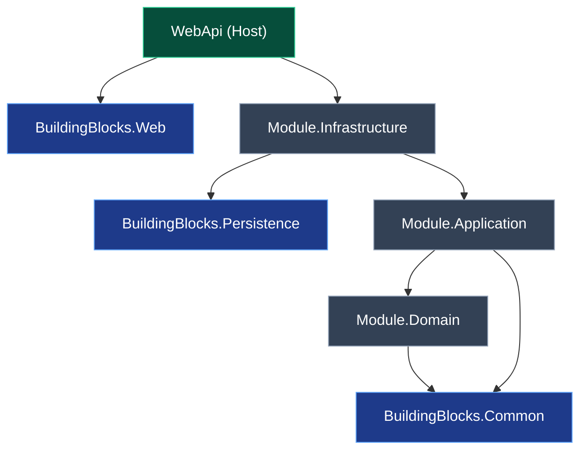
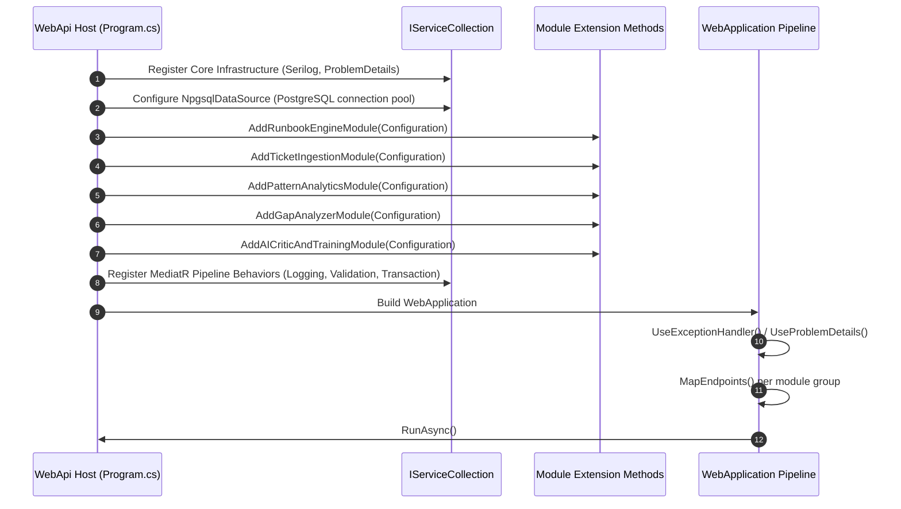

# RunbookForge — System Architecture & Topology Specification
**Document ID:** `docs/00-ARCHITECTURE.md`  
**Version:** 1.1.0  
**Status:** FROZEN  
**System:** RunbookForge (Workspace: `EphemeralEngine`)  

> **Context Dependencies:**  
> - **Source of Truth:** System Topology & Assembly Boundaries (`00-ARCHITECTURE.md`)
> - **Master Navigation:** [00-MASTER-INDEX.md](./00-MASTER-INDEX.md)  
> - **Public Contracts:** [01-MODULE-REGISTRY.md](./01-MODULE-REGISTRY.md)  
> - **Conventions & Guardrails:** [04-CONVENTIONS-AND-GUARDRAILS.md](./04-CONVENTIONS-AND-GUARDRAILS.md)  
> - **Database Master Plan:** [DB-00-MASTER-PLAN.md](./database/DB-00-MASTER-PLAN.md)  
> - **F7Hub Security Barrier:** [DB-06-EXTERNAL-F7HUB-READONLY.md](./database/DB-06-EXTERNAL-F7HUB-READONLY.md)

---

## 1. Architectural Philosophy: The Modular Monolith

RunbookForge is engineered as a **Modular Monolith**. It balances high developer velocity and atomic operational deployment with the strict boundary isolation typically found in distributed microservices.

```mermaid
graph TD
    subgraph ClientTier ["Presentation Tier (Browser / React 19)"]
        SPA["RunbookForge UI<br/>(React 19 + TypeScript + Tailwind CSS + React Flow)"]
    end

    subgraph HostTier ["Runtime Host (.NET 9 / ASP.NET Core)"]
        Host["RunbookForge.WebApi<br/>(Minimal APIs / Composition Root / Auth / Telemetry)"]
        Bus["MediatR In-Process Message Bus<br/>(Validation / Logging / Transaction Behaviors)"]
    end

    subgraph ModuleTier ["Isolated Bounded Contexts (src/Modules/*)"]
        M1["RunbookEngine<br/>(schema: runbooks)"]
        M2["TicketIngestion<br/>(schema: ingestion)"]
        M3["PatternAnalytics<br/>(schema: analytics)"]
        M4["GapAnalyzer<br/>(schema: gaps)"]
        M5["AICriticAndTraining<br/>(schema: training)"]
    end

    subgraph StorageTier ["Data Persistence Tier"]
        PG[("PostgreSQL 17+<br/>Schemas: runbooks, ingestion, analytics, gaps, training")]
        F7[("External F7Hub SQLite<br/>(Mode=ReadOnly; Cache=Shared;)")]
    end

    SPA -->|HTTPS / REST / SSE| Host
    Host --> Bus
    Bus --> M1
    Bus --> M2
    Bus --> M3
    Bus --> M4
    Bus --> M5

    M1 -->|RunbooksDbContext| PG
    M2 -->|IngestionDbContext| PG
    M3 -->|AnalyticsDbContext| PG
    M4 -->|GapsDbContext| PG
    M5 -->|TrainingDbContext| PG

    M2 -.->|F7HubReadOnlyDbContext<br/>(STRICT READ-ONLY)| F7
```

---

## 2. Solution Layout & Directory Structure

All source code resides in `src/`, categorized into shared foundations (`BuildingBlocks`), isolated vertical domains (`Modules`), the deployment host (`WebApi`), and the frontend single-page application (`Frontend`):

```
EphemeralEngine/
├── docs/                                  # Canonical Technical Specifications
│   ├── standards/                         # Language & Toolchain Standards
│   └── database/                          # Database Schemas & DDL Specs
├── src/
│   ├── BuildingBlocks/                    # Shared Foundations (Strictly Domain-Agnostic)
│   │   ├── Common/                        # Result<T>, Error, ICommand, IQuery, IDomainEvent
│   │   ├── Persistence/                   # Postgres & EF Core base configurations, Interceptors
│   │   └── Web/                           # Global Exception Handler, ProblemDetails, Middleware
│   ├── Modules/                           # Isolated Bounded Contexts
│   │   ├── RunbookEngine/                 # Runbook AST Parsing, Step Editor, Versioning
│   │   │   ├── Domain/                    # Entities, Value Objects, Domain Events
│   │   │   ├── Application/               # MediatR Commands, Queries, Validators, Mappings
│   │   │   └── Infrastructure/            # RunbooksDbContext, Repositories, Markdig AST Pipeline
│   │   ├── TicketIngestion/               # Ingestion Workers & Read-Only F7Hub Catalog Sync
│   │   │   ├── Domain/
│   │   │   ├── Application/
│   │   │   └── Infrastructure/            # IngestionDbContext & F7HubReadOnlyDbContext
│   │   ├── PatternAnalytics/              # Telemetry Aggregation, Cluster Mining, Embeddings
│   │   │   ├── Domain/
│   │   │   ├── Application/
│   │   │   └── Infrastructure/            # AnalyticsDbContext, Pgvector Integration
│   │   ├── GapAnalyzer/                   # Coverage Matrix & Gap Evaluation Engine
│   │   │   ├── Domain/
│   │   │   ├── Application/
│   │   │   └── Infrastructure/            # GapsDbContext, Scoring Algorithms
│   │   └── AICriticAndTraining/           # Synthetic Incidents, Operator Drills, Critic Rubric
│   │       ├── Domain/
│   │       ├── Application/
│   │       └── Infrastructure/            # TrainingDbContext, LLM Client Abstractions
│   ├── WebApi/                            # ASP.NET Core Minimal APIs Host (Composition Root)
│   │   ├── Endpoints/                     # Route groups mapping HTTP requests to MediatR
│   │   ├── Extensions/                    # Module DI registrations
│   │   ├── appsettings.json               # Configurations, Connection Strings
│   │   └── Program.cs                     # Process entry point
│   └── Frontend/                          # React 19 Client
│       ├── src/
│       │   ├── api/                       # TanStack Query client & endpoint hooks
│       │   ├── components/                # UI primitives (Tailwind CSS) & React Flow canvas
│       │   ├── features/                  # Feature views matching backend modules
│       │   ├── types/                     # TypeScript interfaces matching backend DTOs 1:1
│       │   ├── App.tsx
│       │   └── main.tsx
│       ├── package.json
│       ├── tsconfig.json
│       └── vite.config.ts
└── tests/                                 # Unit, Integration & End-to-End Test Suites
    ├── BuildingBlocks.Tests/
    ├── Modules/
    │   ├── RunbookEngine.Tests/
    │   ├── TicketIngestion.Tests/
    │   ├── PatternAnalytics.Tests/
    │   ├── GapAnalyzer.Tests/
    │   └── AICriticAndTraining.Tests/
    └── WebApi.IntegrationTests/           # Testcontainers PostgreSQL test suite
```

---

## 3. Strict Assembly Boundary & Reference Rules

To guarantee physical modularity within the single solution, project references must adhere to the following compile-time matrix:



### Compile-Time Dependency Invariants

| Layer / Assembly | Permitted Project References | Prohibited References |
| :--- | :--- | :--- |
| `BuildingBlocks.*` | External NuGet packages only. | Any `Modules.*` or `WebApi`. |
| `Module.Domain` | `BuildingBlocks.Common` only. | `Application`, `Infrastructure`, other Modules, EF Core. |
| `Module.Application` | `Module.Domain`, `BuildingBlocks.Common`. | `Infrastructure`, other Modules, direct EF Core migrations. |
| `Module.Infrastructure` | `Module.Application`, `BuildingBlocks.Persistence`. | Other Modules' internal projects. |
| `WebApi` | All `Module.Infrastructure` (for DI registration only), `BuildingBlocks.Web`. | Bypassing MediatR to invoke internal module handlers directly. |

> [!CAUTION]
> **Inter-Module Isolation Barrier:**  
> `RunbookEngine` must NEVER reference `TicketIngestion`, `PatternAnalytics`, `GapAnalyzer`, or `AICriticAndTraining` assemblies.  
> Cross-module interaction occurs strictly through MediatR contracts defined in `BuildingBlocks.Common.Contracts` (see [01-MODULE-REGISTRY.md](./01-MODULE-REGISTRY.md)) or asynchronous domain events (see [02-DATA-FLOW-AND-EVENTS.md](./02-DATA-FLOW-AND-EVENTS.md)).

---

## 4. Database Topology & Multi-Schema Isolation

RunbookForge utilizes a single PostgreSQL instance logically partitioned into five isolated schemas:

```
PostgreSQL Database: "runbookforge"
├── Schema: runbooks      (Managed by RunbooksDbContext)
├── Schema: ingestion     (Managed by IngestionDbContext)
├── Schema: analytics     (Managed by AnalyticsDbContext)
├── Schema: gaps          (Managed by GapsDbContext)
└── Schema: training      (Managed by TrainingDbContext)
```

For connection pooling configurations, transaction boundaries, and the migration isolation policy, see [DB-00-MASTER-PLAN.md](./database/DB-00-MASTER-PLAN.md#1-relational-topology-multi-schema-architecture).

---

## 5. F7Hub Read-Only Security Barrier

The external F7Hub SQLite database contains legacy incident records, runbook historical logs, and troubleshooting transcripts.

```mermaid
sequenceDiagram
    autonumber
    participant Ingest as TicketIngestion Worker
    participant Context as F7HubReadOnlyDbContext
    participant Driver as Microsoft.Data.Sqlite
    participant File as f7hub.db (File System)

    Ingest->>Context: Query legacy incident records
    Context->>Driver: Open Connection (Mode=ReadOnly; Cache=Shared;)
    Driver->>File: File lock (Shared Read Lock)
    File-->>Driver: Return record streams
    Driver-->>Context: Read without Change Tracking
    Context-->>Ingest: Return ReadOnlyList<F7LegacyIncident>

    Note over Ingest,Context: Any attempt to mutate throws InvalidOperationException
    opt Accidental Write Attempt
        Ingest->>Context: SaveChangesAsync()
        Context-->>Ingest: throw InvalidOperationException("F7Hub is an immutable read-only catalog.")
    end
```

### Architectural Guardrails for F7Hub:
1. **Access Scope:** The `F7HubReadOnlyDbContext` class is internal to `RunbookForge.Modules.TicketIngestion.Infrastructure`. No other module can resolve or instantiate it.
2. **Immutable Connection String:** `Data Source=f7hub.db;Mode=ReadOnly;Cache=Shared;`.
3. **Global No-Tracking:** Configured with `QueryTrackingBehavior.NoTracking`.
4. **Hard Exception on Mutation:** Overrides `SaveChangesAsync` and `SaveChanges` to unconditionally throw `InvalidOperationException`.

For complete entity mappings and DI registration, see the canonical [F7Hub Read-Only Adapter Specification](./database/DB-06-EXTERNAL-F7HUB-READONLY.md#2-hardened-f7hubreadonlydbcontext-implementation).

---

## 6. Host Bootstrapping & Composition Root (`Program.cs`)

`RunbookForge.WebApi` acts as the host and composition root. Its lifecycle sequence executes as follows:



### Minimal API Endpoint Registration Pattern
Each module exposes an `IEndpointModule` contract implemented in its Application/Infrastructure layer:
```csharp
public interface IEndpointModule
{
    void MapEndpoints(IEndpointRouteBuilder app);
}
```
During host bootstrapping, `Program.cs` scans and discovers all `IEndpointModule` implementations, mapping module route groups cleanly without leaking internal module types into the WebApi project.
