# RunbookForge — Master Architectural Index & Context Graph
**Document ID:** `docs/00-MASTER-INDEX.md`  
**Version:** 1.1.0  
**Status:** FROZEN  
**System:** RunbookForge (Workspace: `EphemeralEngine`)  

> **Context Dependencies:**  
> - **Source of Truth:** Master Navigation & Document Catalog (`00-MASTER-INDEX.md`)
> - **System Architecture:** [00-ARCHITECTURE.md](./00-ARCHITECTURE.md)
> - **Global Agent Instructions:** [AGENTS.md](./AGENTS.md)
> - **Standards Index:** [standards/AGENTS.md](./standards/AGENTS.md)
> - **Database Index:** [database/AGENTS.md](./database/AGENTS.md)

---

## 1. Executive Summary

RunbookForge is a high-reliability, modular monolith designed for operational runbook authoring, automated linting, telemetry-driven gap detection, and operator training drills. 

This repository enforces strict physical modularity across five domain modules hosted within a unified .NET 9 ASP.NET Core process, coupled with an interactive React 19 frontend and an isolated PostgreSQL multi-schema database architecture. It features a hardened, read-only adapter to legacy F7Hub SQLite incident catalogs.

This document serves as the canonical navigational entry point and context dependency graph for human engineers and autonomous AI agents (operating via Google AI Studio and Antigravity IDE).

---

## 2. Global Document Registry & Summaries

The specification matrix comprises 23 documents across three tiers:

### 2.1 Core System Architecture & SOPs (`docs/`)

| Document | Purpose & Architectural Scope | Upstream Slices | Downstream Slices |
| :--- | :--- | :--- | :--- |
| [`00-MASTER-INDEX.md`](./00-MASTER-INDEX.md) | AI root navigation, context matrix slicing guide, and full dependency graph. | *Root* | All Documents |
| [`00-ARCHITECTURE.md`](./00-ARCHITECTURE.md) | System topology, solution layout (`src/`), assembly boundaries, and host composition. | `00-MASTER-INDEX.md` | `01-MODULE-REGISTRY.md`, `04-CONVENTIONS-AND-GUARDRAILS.md` |
| [`01-MODULE-REGISTRY.md`](./01-MODULE-REGISTRY.md) | Public API contracts, MediatR Commands/Queries, Domain Events, and DTOs for all 5 modules. | `00-ARCHITECTURE.md` | `02-DATA-FLOW-AND-EVENTS.md`, `03-AI-FEATURE-SOP.md` |
| [`02-DATA-FLOW-AND-EVENTS.md`](./02-DATA-FLOW-AND-EVENTS.md) | Cross-module sequence diagrams, MediatR pipeline behaviors, and JSON event schemas. | `01-MODULE-REGISTRY.md` | `03-AI-FEATURE-SOP.md` |
| [`03-AI-FEATURE-SOP.md`](./03-AI-FEATURE-SOP.md) | Deterministic 6-phase implementation recipe for AI agents generating feature slices. | `00-ARCHITECTURE.md`, `04-CONVENTIONS-AND-GUARDRAILS.md` | `05-FEATURE-STATE-INDEX.md` |
| [`04-CONVENTIONS-AND-GUARDRAILS.md`](./04-CONVENTIONS-AND-GUARDRAILS.md) | Cross-cutting architectural rules, C# `Result<T>` pattern, and HTTP ProblemDetails mappings. | `00-ARCHITECTURE.md` | `03-AI-FEATURE-SOP.md`, Standards |
| [`05-FEATURE-STATE-INDEX.md`](./05-FEATURE-STATE-INDEX.md) | Living feature tracking matrix, milestone roadmap, and execution status index. | `03-AI-FEATURE-SOP.md` | Active Slices |
| [`AGENTS.md`](./AGENTS.md) | Root agent execution guardrails, verification commands, and invariant defense protocols. | `00-MASTER-INDEX.md` | All Tasks |

### 2.2 Engineering Standards (`docs/standards/`)

| Document | Purpose & Architectural Scope | Upstream Slices | Downstream Slices |
| :--- | :--- | :--- | :--- |
| [`standards/AGENTS.md`](./standards/AGENTS.md) | Agent protocol for reviewing and modifying engineering standards. | `00-MASTER-INDEX.md` | Standards |
| [`standards/CSHARP-STANDARDS.md`](./standards/CSHARP-STANDARDS.md) | .NET 9, C# 13, MediatR pipelines, FluentValidation, and EF Core configuration. | `04-CONVENTIONS-AND-GUARDRAILS.md` | Backend Code |
| [`standards/TYPESCRIPT-REACT-STANDARDS.md`](./standards/TYPESCRIPT-REACT-STANDARDS.md) | React 19, strict TypeScript, TanStack Query key factories, Tailwind, and React Flow. | `04-CONVENTIONS-AND-GUARDRAILS.md` | Frontend Code |
| [`standards/POSTGRES-SQL-STANDARDS.md`](./standards/POSTGRES-SQL-STANDARDS.md) | PostgreSQL naming, isolated migrations, B-Tree/GIN indexing, and `xmin` MVCC. | `04-CONVENTIONS-AND-GUARDRAILS.md` | `database/` |
| [`standards/MARKDOWN-PARSER-STANDARDS.md`](./standards/MARKDOWN-PARSER-STANDARDS.md) | Markdig AST pipeline, custom block grammar, and `RF001`–`RF099` diagnostic codes. | `01-MODULE-REGISTRY.md` | `RunbookEngine` |
| [`standards/TESTING-STANDARDS.md`](./standards/TESTING-STANDARDS.md) | xUnit, FluentAssertions, Testcontainers for PostgreSQL, and Vitest suite patterns. | `03-AI-FEATURE-SOP.md` | All Tests |
| [`standards/AI-INTEGRATION-STANDARDS.md`](./standards/AI-INTEGRATION-STANDARDS.md) | LLM provider abstractions, strict JSON schema validation, and token budgets. | `01-MODULE-REGISTRY.md` | `AICriticAndTraining` |

### 2.3 Database Schemas & Adapters (`docs/database/`)

| Document | Purpose & Architectural Scope | Upstream Slices | Downstream Slices |
| :--- | :--- | :--- | :--- |
| [`database/AGENTS.md`](./database/AGENTS.md) | Agent instructions for database schema changes and migration authoring. | `00-MASTER-INDEX.md` | `database/` |
| [`database/DB-00-MASTER-PLAN.md`](./database/DB-00-MASTER-PLAN.md) | Multi-schema architecture, connection pooling, and cross-schema isolation policies. | `00-ARCHITECTURE.md` | `DB-01`–`DB-06` |
| [`database/DB-01-SCHEMA-RUNBOOKS.md`](./database/DB-01-SCHEMA-RUNBOOKS.md) | DDL, tables, and JSONB schemas for `runbooks.documents`, `versions`, `lint_results`. | `DB-00-MASTER-PLAN.md` | `RunbookEngine` |
| [`database/DB-02-SCHEMA-INGESTION.md`](./database/DB-02-SCHEMA-INGESTION.md) | DDL for `ingestion.sync_jobs`, `ingestion.raw_tickets`, and content deduplication hashes. | `DB-00-MASTER-PLAN.md`, `DB-06` | `TicketIngestion` |
| [`database/DB-03-SCHEMA-ANALYTICS.md`](./database/DB-03-SCHEMA-ANALYTICS.md) | DDL for `analytics.symptom_clusters`, `timelines`, `pgvector` embeddings & fallback. | `DB-00-MASTER-PLAN.md` | `PatternAnalytics` |
| [`database/DB-04-SCHEMA-GAPS.md`](./database/DB-04-SCHEMA-GAPS.md) | DDL for `gaps.coverage_reports` and `gaps.missing_patterns`. | `DB-00-MASTER-PLAN.md` | `GapAnalyzer` |
| [`database/DB-05-SCHEMA-TRAINING.md`](./database/DB-05-SCHEMA-TRAINING.md) | DDL for `training.practice_scenarios` and `training.evaluation_logs`. | `DB-00-MASTER-PLAN.md` | `AICriticAndTraining` |
| [`database/DB-06-EXTERNAL-F7HUB-READONLY.md`](./database/DB-06-EXTERNAL-F7HUB-READONLY.md) | SQLite read-only adapter specs, EF Core security barriers, and legacy table mappings. | `00-ARCHITECTURE.md`, `DB-02` | `TicketIngestion` |

---

## 3. Global File Dependency Graph

```mermaid
graph TD
    classDef root fill:#1e293b,stroke:#0ea5e9,stroke-width:2px,color:#f8fafc;
    classDef arch fill:#334155,stroke:#38bdf8,stroke-width:1px,color:#f8fafc;
    classDef std fill:#1e3a8a,stroke:#60a5fa,stroke-width:1px,color:#f8fafc;
    classDef db fill:#064e3b,stroke:#34d399,stroke-width:1px,color:#f8fafc;

    MI["00-MASTER-INDEX.md"]:::root

    subgraph Tier1 ["Tier 1: System Architecture & SOPs"]
        Arch["00-ARCHITECTURE.md"]:::arch
        Reg["01-MODULE-REGISTRY.md"]:::arch
        Flow["02-DATA-FLOW-AND-EVENTS.md"]:::arch
        SOP["03-AI-FEATURE-SOP.md"]:::arch
        Guard["04-CONVENTIONS-AND-GUARDRAILS.md"]:::arch
        State["05-FEATURE-STATE-INDEX.md"]:::arch
        Agent["AGENTS.md"]:::arch
    end

    subgraph Tier2 ["Tier 2: Engineering Standards"]
        StdAgent["standards/AGENTS.md"]:::std
        CS["CSHARP-STANDARDS.md"]:::std
        TS["TYPESCRIPT-REACT-STANDARDS.md"]:::std
        PG["POSTGRES-SQL-STANDARDS.md"]:::std
        MD["MARKDOWN-PARSER-STANDARDS.md"]:::std
        Test["TESTING-STANDARDS.md"]:::std
        AI["AI-INTEGRATION-STANDARDS.md"]:::std
    end

    subgraph Tier3 ["Tier 3: Database & Adapters"]
        DBAgent["database/AGENTS.md"]:::db
        DBMaster["DB-00-MASTER-PLAN.md"]:::db
        DB1["DB-01-SCHEMA-RUNBOOKS.md"]:::db
        DB2["DB-02-SCHEMA-INGESTION.md"]:::db
        DB3["DB-03-SCHEMA-ANALYTICS.md"]:::db
        DB4["DB-04-SCHEMA-GAPS.md"]:::db
        DB5["DB-05-SCHEMA-TRAINING.md"]:::db
        DB6["DB-06-EXTERNAL-F7HUB-READONLY.md"]:::db
    end

    MI --> Arch
    MI --> Agent
    MI --> StdAgent
    MI --> DBAgent

    Arch --> Reg
    Arch --> Guard
    Arch --> DBMaster
    Arch --> DB6

    Reg --> Flow
    Reg --> MD
    Reg --> AI

    Flow --> SOP
    Guard --> CS
    Guard --> TS
    Guard --> PG
    Guard --> SOP

    SOP --> Test
    SOP --> State

    DBMaster --> DB1
    DBMaster --> DB2
    DBMaster --> DB3
    DBMaster --> DB4
    DBMaster --> DB5
    DB2 --> DB6
```



---

## 4. Context Matrix Slicing Protocol

When assembling prompt payloads in **Google AI Studio** or triggering autonomous development in **Antigravity IDE**, developers and agents MUST slice context according to the targeted technical layer:

### Slicing Recipes by Task Type

```
Task Type: Backend MediatR Feature Implementation
├── Base Architecture: [00-ARCHITECTURE.md](./00-ARCHITECTURE.md)
├── Coding Guardrails: [04-CONVENTIONS-AND-GUARDRAILS.md](./04-CONVENTIONS-AND-GUARDRAILS.md)
├── Language Standards: [standards/CSHARP-STANDARDS.md](./standards/CSHARP-STANDARDS.md)
├── Public Contracts: [01-MODULE-REGISTRY.md](./01-MODULE-REGISTRY.md)
└── Database Target: [database/DB-01-SCHEMA-RUNBOOKS.md](./database/DB-01-SCHEMA-RUNBOOKS.md) through DB-05

Task Type: Ingestion & F7Hub Sync Pipeline
├── Base Architecture: [00-ARCHITECTURE.md](./00-ARCHITECTURE.md)
├── Ingestion Contracts: [01-MODULE-REGISTRY.md](./01-MODULE-REGISTRY.md)
├── Ingestion Schema: [database/DB-02-SCHEMA-INGESTION.md](./database/DB-02-SCHEMA-INGESTION.md)
└── F7Hub Adapter Spec: [database/DB-06-EXTERNAL-F7HUB-READONLY.md](./database/DB-06-EXTERNAL-F7HUB-READONLY.md)

Task Type: Markdig AST & Linter Development
├── Base Architecture: [00-ARCHITECTURE.md](./00-ARCHITECTURE.md)
├── Parser Specification: [standards/MARKDOWN-PARSER-STANDARDS.md](./standards/MARKDOWN-PARSER-STANDARDS.md)
├── Runbooks Contracts: [01-MODULE-REGISTRY.md](./01-MODULE-REGISTRY.md)
└── Runbooks Schema: [database/DB-01-SCHEMA-RUNBOOKS.md](./database/DB-01-SCHEMA-RUNBOOKS.md)

Task Type: React 19 / React Flow UI Construction
├── Base Architecture: [00-ARCHITECTURE.md](./00-ARCHITECTURE.md)
├── Frontend Standards: [standards/TYPESCRIPT-REACT-STANDARDS.md](./standards/TYPESCRIPT-REACT-STANDARDS.md)
├── Public Contracts: [01-MODULE-REGISTRY.md](./01-MODULE-REGISTRY.md)
└── Workflow Schema: [database/DB-01-SCHEMA-RUNBOOKS.md](./database/DB-01-SCHEMA-RUNBOOKS.md)

Task Type: Database Migrations & DDL Authoring
├── Database Master Plan: [database/DB-00-MASTER-PLAN.md](./database/DB-00-MASTER-PLAN.md)
├── PostgreSQL Standards: [standards/POSTGRES-SQL-STANDARDS.md](./standards/POSTGRES-SQL-STANDARDS.md)
└── Target Schema Spec: [database/DB-01-SCHEMA-RUNBOOKS.md](./database/DB-01-SCHEMA-RUNBOOKS.md) through DB-05
```

---

## 5. Non-Negotiable Invariant Checklist

Every autonomous agent session MUST verify conformance against these four pillars before proposing or applying code:

- [ ] **1. F7Hub Read-Only Barrier:** Connection string `Data Source=f7hub.db;Mode=ReadOnly;Cache=Shared;` enforced. Global `NoTracking` active. `SaveChangesAsync()` throws `InvalidOperationException`. Reference restricted exclusively to `TicketIngestion` (see [DB-06-EXTERNAL-F7HUB-READONLY.md](./database/DB-06-EXTERNAL-F7HUB-READONLY.md)).
- [ ] **2. PostgreSQL Schema Isolation:** Zero direct cross-schema foreign keys. Zero cross-module `DbContext` injections. Inter-module communication flows exclusively via MediatR Commands/Queries or Domain Events (see [DB-00-MASTER-PLAN.md](./database/DB-00-MASTER-PLAN.md)).
- [ ] **3. Explicit Result Flow Control:** C# handlers return `Result<T>` or `Result.Failure(Error)`. Zero business exceptions thrown (see [04-CONVENTIONS-AND-GUARDRAILS.md](./04-CONVENTIONS-AND-GUARDRAILS.md#2-definitive-result-pattern-implementation)).
- [ ] **4. Bi-Directional Markdown Links:** Every specification document declares upstream, downstream, and companion dependencies in its header blockquote.
