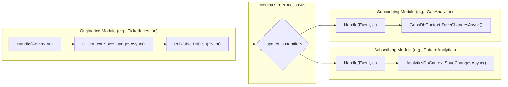
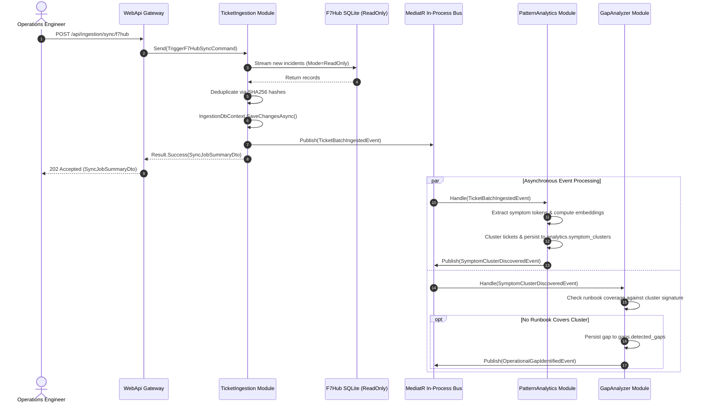
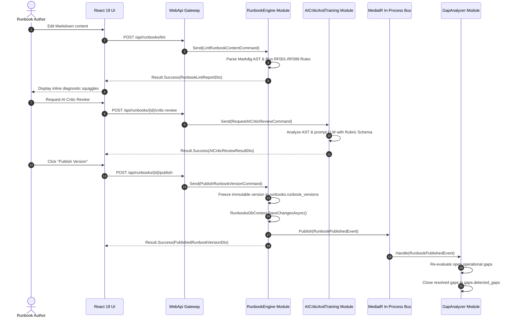
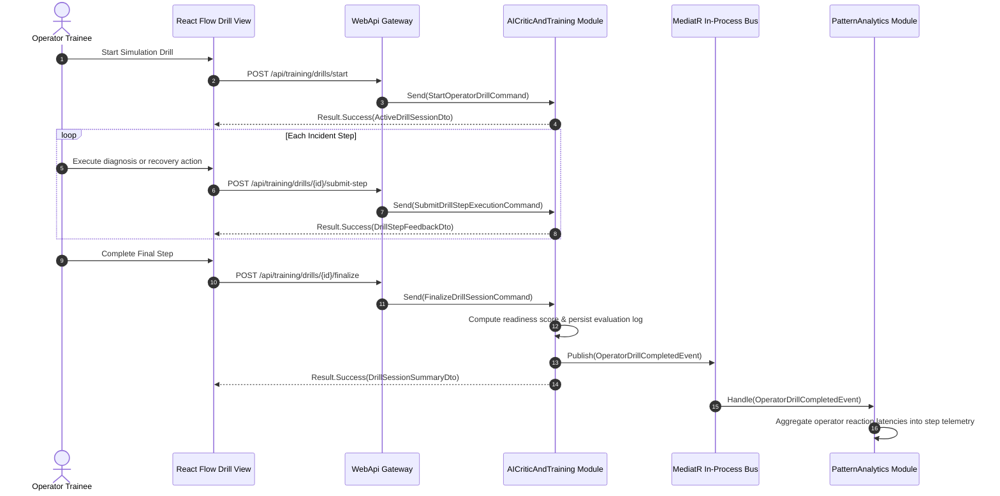

# RunbookForge — Data Flow, Sequences & Event Specifications
**Document ID:** `docs/02-DATA-FLOW-AND-EVENTS.md`  
**Version:** 1.1.0  
**Status:** FROZEN  
**System:** RunbookForge (Workspace: `EphemeralEngine`)  

> **Context Dependencies:**  
> - **Source of Truth:** Sequence Flows & Event Payloads (`02-DATA-FLOW-AND-EVENTS.md`)
> - **Public Contracts:** [01-MODULE-REGISTRY.md](./01-MODULE-REGISTRY.md)  
> - **Implementation SOP:** [03-AI-FEATURE-SOP.md](./03-AI-FEATURE-SOP.md)  
> - **Database Master Plan:** [database/DB-00-MASTER-PLAN.md](./database/DB-00-MASTER-PLAN.md)

---

## 1. Event Dispatching Architecture

RunbookForge uses **MediatR In-Process Notifications** (`INotification` / `INotificationHandler<T>`) for cross-module side effects. This ensures:
1. **Decoupled Execution:** Modules do not know about other modules' handlers or database models.
2. **Transactional Boundary Safety:** A command handler commits its own module's `DbContext` transaction *before* publishing domain events. Downstream event handlers execute in independent transaction scopes.
3. **Resilience:** Failure in an asynchronous downstream notification handler does not roll back the upstream primary mutation.



---

## 2. Core Cross-Module Sequence Diagrams

### Flow 1: F7Hub Ingestion -> Pattern Mining -> Operational Gap Detection



---

### Flow 2: Runbook Authoring -> Markdig Linting -> AI Critic Review -> Version Publication



---

### Flow 3: Interactive Operator Drill -> Step Telemetry -> Efficiency Metrics



---

## 3. Concrete Domain Event JSON Schemas

### 3.1 `TicketBatchIngestedEvent`
```json
{
  "$schema": "https://json-schema.org/draft/2020-12/schema",
  "title": "TicketBatchIngestedEvent",
  "type": "object",
  "properties": {
    "eventId": { "type": "string", "format": "uuid" },
    "syncJobId": { "type": "string", "format": "uuid" },
    "sourceCatalog": { "type": "string", "enum": ["F7HubSQLite", "ServiceNowApi", "JiraServiceDesk"] },
    "ingestedTicketCount": { "type": "integer", "minimum": 1 },
    "ingestedTicketIds": {
      "type": "array",
      "items": { "type": "string", "format": "uuid" }
    },
    "completedAtUtc": { "type": "string", "format": "date-time" }
  },
  "required": ["eventId", "syncJobId", "sourceCatalog", "ingestedTicketCount", "ingestedTicketIds", "completedAtUtc"],
  "additionalProperties": false
}
```

### 3.2 `SymptomClusterDiscoveredEvent`
```json
{
  "$schema": "https://json-schema.org/draft/2020-12/schema",
  "title": "SymptomClusterDiscoveredEvent",
  "type": "object",
  "properties": {
    "eventId": { "type": "string", "format": "uuid" },
    "clusterId": { "type": "string", "format": "uuid" },
    "clusterSignature": { "type": "string", "example": "SIG_POSTGRES_CONNECTION_POOL_EXHAUSTION" },
    "ticketFrequency": { "type": "integer", "minimum": 1 },
    "affectedSubsystem": { "type": "string", "example": "CoreDatabasePersistence" },
    "discoveredAtUtc": { "type": "string", "format": "date-time" }
  },
  "required": ["eventId", "clusterId", "clusterSignature", "ticketFrequency", "affectedSubsystem", "discoveredAtUtc"],
  "additionalProperties": false
}
```

### 3.3 `RunbookPublishedEvent`
```json
{
  "$schema": "https://json-schema.org/draft/2020-12/schema",
  "title": "RunbookPublishedEvent",
  "type": "object",
  "properties": {
    "eventId": { "type": "string", "format": "uuid" },
    "runbookId": { "type": "string", "format": "uuid" },
    "versionNumber": { "type": "integer", "minimum": 1 },
    "title": { "type": "string" },
    "slug": { "type": "string" },
    "tags": {
      "type": "array",
      "items": { "type": "string" }
    },
    "publishedAt": { "type": "string", "format": "date-time" }
  },
  "required": ["eventId", "runbookId", "versionNumber", "title", "slug", "tags", "publishedAt"],
  "additionalProperties": false
}
```

### 3.4 `OperationalGapIdentifiedEvent`
```json
{
  "$schema": "https://json-schema.org/draft/2020-12/schema",
  "title": "OperationalGapIdentifiedEvent",
  "type": "object",
  "properties": {
    "eventId": { "type": "string", "format": "uuid" },
    "gapId": { "type": "string", "format": "uuid" },
    "symptomClusterId": { "type": "string", "format": "uuid" },
    "subsystem": { "type": "string" },
    "urgencyTier": { "type": "string", "enum": ["Critical", "High", "Medium", "Low"] },
    "affectedIncidentCount": { "type": "integer", "minimum": 1 },
    "detectedAtUtc": { "type": "string", "format": "date-time" }
  },
  "required": ["eventId", "gapId", "symptomClusterId", "subsystem", "urgencyTier", "affectedIncidentCount", "detectedAtUtc"],
  "additionalProperties": false
}
```
