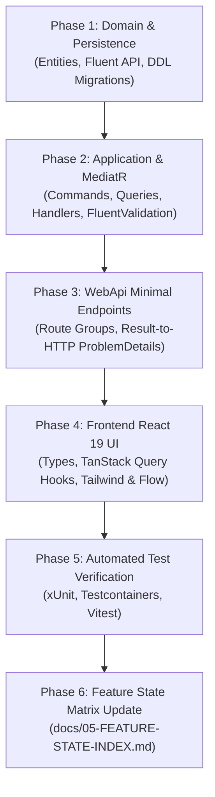

# RunbookForge — AI Feature Implementation SOP (6-Phase Protocol)
**Document ID:** `docs/03-AI-FEATURE-SOP.md`  
**Version:** 1.1.0  
**Status:** FROZEN  
**System:** RunbookForge (Workspace: `EphemeralEngine`)  

> **Context Dependencies:**  
> - **Source of Truth:** Feature Delivery Lifecycle (`03-AI-FEATURE-SOP.md`)
> - **System Architecture:** [00-ARCHITECTURE.md](./00-ARCHITECTURE.md)  
> - **Conventions & Guardrails:** [04-CONVENTIONS-AND-GUARDRAILS.md](./04-CONVENTIONS-AND-GUARDRAILS.md)  
> - **Feature State Index:** [05-FEATURE-STATE-INDEX.md](./05-FEATURE-STATE-INDEX.md)  
> - **Testing Standards:** [standards/TESTING-STANDARDS.md](./standards/TESTING-STANDARDS.md)

---

## 1. Operating Protocol Overview

Any AI agent (operating within **Antigravity IDE** or prompted via **Google AI Studio**) implementing a feature or bugfix in RunbookForge MUST execute the implementation according to this **Deterministic 6-Phase Recipe**.

Atomic execution is strictly enforced. Never commit code that skips validation phases or mixes multi-tier concerns out of sequence.



---

## 2. Phase-by-Phase Implementation Protocol

### Phase 1: Domain & Persistence
1. **Identify the Target Module:** Confirm target bounded context and schema (`runbooks`, `ingestion`, `analytics`, `gaps`, `training`).
2. **Entity Modeling (`src/Modules/{Module}/Domain/`):**
   - Create domain entities deriving from `Entity<TId>` or `AggregateRoot<TId>`.
   - Encapsulate invariants using private parameterless constructors and static factory methods.
   - Guard against business exceptions; factory methods return `Result<TEntity>`.
3. **EF Core Configuration (`src/Modules/{Module}/Infrastructure/Persistence/Configurations/`):**
   - Implement `IEntityTypeConfiguration<TEntity>`.
   - Explicitly configure table name and schema: `builder.ToTable("entity_plural", "target_schema");`.
   - Map properties to `snake_case` column names.
   - Configure optimistic concurrency via `.IsRowVersion().HasColumnName("xmin");`.
4. **Author Migration:** Generate isolated migration targeting the module's migration history table.

---

### Phase 2: Application Layer (MediatR & CQRS)
1. **Declare Contracts (`src/BuildingBlocks/Common/Contracts/{Module}/`):**
   - Declare Command/Query records as `sealed record`.
   - Ensure all requests implement `ICommand<Result<TResponse>>` or `IQuery<Result<TResponse>>`.
2. **Create Feature Slice Directory (`src/Modules/{Module}/Application/Features/{FeatureName}/`):**
   - Place Command/Query, Handler, and Validator together in the feature folder.
3. **Implement FluentValidation (`{FeatureName}Validator.cs`):**
   - Inherit from `AbstractValidator<TRequest>`.
   - Define explicit error codes matching the validation failure taxonomy (e.g., `Runbook.TitleRequired`).
4. **Implement MediatR Handler (`{FeatureName}Handler.cs`):**
   - Accept `CancellationToken cancellationToken` on all I/O paths.
   - Return `Result<TDto>.Success(dto)` or `Result.Failure(Error)`.

---

### Phase 3: WebApi & Minimal Endpoints
1. **Define Route Group (`src/WebApi/Endpoints/{Module}Endpoints.cs`):**
   - Register endpoint in an `IEndpointModule` implementation.
   - Tag group with the module name for OpenAPI/Swagger documentation.
2. **Map Result to HTTP Status:**
   - Map `Result<T>` to HTTP status using the global `ToHttpResult()` extension:
     - `IsSuccess` -> `Results.Ok(value)` or `Results.CreatedAtRoute(...)`.
     - `ErrorType.Validation` -> `Results.Problem(statusCode: 400, ...)` (RFC 7807).
     - `ErrorType.NotFound` -> `Results.Problem(statusCode: 404, ...)`.
     - `ErrorType.Conflict` -> `Results.Problem(statusCode: 409, ...)`.
     - `ErrorType.Unauthorized` -> `Results.Problem(statusCode: 401, ...)`.

---

### Phase 4: Frontend (React 19 & TypeScript)
1. **Synchronize Types (`src/Frontend/src/types/{module}.ts`):**
   - Create TypeScript interfaces matching backend DTOs 1:1.
   - Enforce zero-`any` policy (`strict: true`).
2. **Author TanStack Query Hooks (`src/Frontend/src/api/{module}Queries.ts`):**
   - Use centralized query key factories: `runbookKeys.detail(id)`.
   - In mutations, invalidate related queries in `onSuccess`.
3. **Build Components (`src/Frontend/src/features/{module}/`):**
   - Tailwind CSS for responsive utility styling.
   - React Flow custom nodes/edges for workflow and step tree rendering.
   - Wrap components in declarative Error Boundaries and loading skeletons.

---

### Phase 5: Verification & Testing
Before declaring a slice complete, the agent must execute and pass all verification tests:

1. **Unit Testing (`tests/Modules/{Module}.Tests/`):**
   - Handler tests with mock/substitute repositories verifying both success and failure branches.
   - Validator tests covering edge cases and empty payloads.
2. **Integration Testing (`tests/WebApi.IntegrationTests/`):**
   - Testcontainers for PostgreSQL verifying actual schema migrations and queries.
3. **Terminal Verification Commands:**
   ```powershell
   # 1. Compile backend with zero warnings
   dotnet build --configuration Release

   # 2. Run backend test suite
   dotnet test --no-build --verbosity normal

   # 3. Typecheck and lint frontend
   cd src/Frontend && npm run typecheck && npm run test && cd ../..
   ```

---

### Phase 6: Feature State Matrix Update
Update [05-FEATURE-STATE-INDEX.md](./05-FEATURE-STATE-INDEX.md):
- Transition the task status from `PLANNED` or `IN_PROGRESS` to `COMPLETED`.
- Record PR / commit hash, test coverage count, and any downstream dependencies unblocked.
