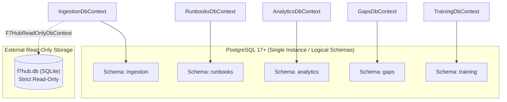

# RunbookForge — Database Master Plan & Multi-Schema Strategy
**Document ID:** `docs/database/DB-00-MASTER-PLAN.md`  
**Version:** 1.1.0  
**Status:** FROZEN  
**System:** RunbookForge (Workspace: `EphemeralEngine`)  

> **Context Dependencies:**  
> - **Source of Truth:** PostgreSQL Topology & Multi-Schema Isolation (`database/DB-00-MASTER-PLAN.md`)
> - **System Architecture:** [../00-ARCHITECTURE.md](../00-ARCHITECTURE.md)  
> - **PostgreSQL Standards:** [../standards/POSTGRES-SQL-STANDARDS.md](../standards/POSTGRES-SQL-STANDARDS.md)  
> - **Module Schemas:** [./DB-01-SCHEMA-RUNBOOKS.md](./DB-01-SCHEMA-RUNBOOKS.md) through DB-05  
> - **F7Hub Security Barrier:** [./DB-06-EXTERNAL-F7HUB-READONLY.md](./DB-06-EXTERNAL-F7HUB-READONLY.md)

---

## 1. Relational Topology & Multi-Schema Architecture
<a id="relational-topology"></a>

RunbookForge deploys a single PostgreSQL 17+ instance physically hosting five isolated schemas:

```
Database: runbookforge
├── Schema: runbooks     (Owned exclusively by RunbooksDbContext)
├── Schema: ingestion    (Owned exclusively by IngestionDbContext)
├── Schema: analytics    (Owned exclusively by AnalyticsDbContext)
├── Schema: gaps         (Owned exclusively by GapsDbContext)
└── Schema: training     (Owned exclusively by TrainingDbContext)
```



---

## 2. Multi-Schema Isolation Policy

1. **Physical Independence:** Each schema is completely decoupled. There are **zero cross-schema foreign keys**.
2. **Migration History Isolation:** Each module's `DbContext` maintains its own migration history table within its own schema namespace:
   ```sql
   runbooks.__EFMigrationsHistory
   ingestion.__EFMigrationsHistory
   analytics.__EFMigrationsHistory
   gaps.__EFMigrationsHistory
   training.__EFMigrationsHistory
   ```
3. **Future Microservices Read-Readiness:** Because schemas share no database-level constraints or cross-queries, any schema can be extracted into an independent database instance in the future with zero code refactoring.

---

## 3. Connection Pooling via `NpgsqlDataSource`

Connection pooling is centralized at the host level via `NpgsqlDataSource`:

```csharp
var dataSourceBuilder = new NpgsqlDataSourceBuilder(builder.Configuration.GetConnectionString("PostgresDatabase"));
dataSourceBuilder.UseVector(); // Registers pgvector plugin
var dataSource = dataSourceBuilder.Build();

builder.Services.AddSingleton(dataSource);

// Register individual DbContexts pointing to the shared dataSource
builder.Services.AddDbContext<RunbooksDbContext>((sp, options) =>
{
    var ds = sp.GetRequiredService<NpgsqlDataSource>();
    options.UseNpgsql(ds, npgsql =>
    {
        npgsql.MigrationsHistoryTable("__EFMigrationsHistory", "runbooks");
    });
});
```

---

## 4. Concurrency & Transaction Isolation

- **Default Isolation Level:** `READ COMMITTED`.
- **Optimistic Concurrency:** Enforced across all mutable tables via PostgreSQL system column `xmin`.
- **Transaction Scope:** Transactions are scoped strictly to the module command handling pipeline; cross-module distributed transactions (2PC) are forbidden.
