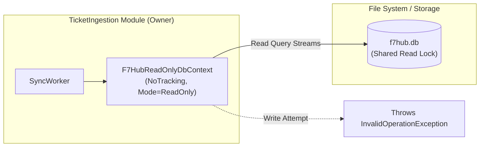

# RunbookForge — External F7Hub SQLite Read-Only Adapter Specification
**Document ID:** `docs/database/DB-06-EXTERNAL-F7HUB-READONLY.md`  
**Version:** 1.1.0  
**Status:** FROZEN  
**System:** RunbookForge (Workspace: `EphemeralEngine`)  

> **Context Dependencies:**  
> - **Source of Truth:** F7Hub SQLite Read-Only Adapter & Guardrails (`database/DB-06-EXTERNAL-F7HUB-READONLY.md`)
> - **System Architecture:** [../00-ARCHITECTURE.md](../00-ARCHITECTURE.md)  
> - **Ingestion Schema:** [./DB-02-SCHEMA-INGESTION.md](./DB-02-SCHEMA-INGESTION.md)  
> - **Conventions & Guardrails:** [../04-CONVENTIONS-AND-GUARDRAILS.md](../04-CONVENTIONS-AND-GUARDRAILS.md)  
> - **Testing Standards:** [../standards/TESTING-STANDARDS.md](../standards/TESTING-STANDARDS.md)

---

## 1. Architectural Role & Security Boundary

The legacy F7Hub system stores historical incident transcripts, resolution post-mortems, and troubleshooting runbook archives in an external SQLite database (`f7hub.db`).

RunbookForge interfaces with this legacy store strictly for ingestion and synchronization. 

> [!CAUTION]
> **Immutability Invariant:**  
> The F7Hub database is an immutable historical record. Under no circumstances may RunbookForge modify, update, insert, delete, or run migrations against `f7hub.db`.



---

## 2. Hardened `F7HubReadOnlyDbContext` Implementation
<a id="hardened-context"></a>

The EF Core context resides exclusively in `RunbookForge.Modules.TicketIngestion.Infrastructure`:

```csharp
namespace RunbookForge.Modules.TicketIngestion.Infrastructure.Persistence;

using Microsoft.EntityFrameworkCore;
using Microsoft.Data.Sqlite;

public sealed class F7HubReadOnlyDbContext : DbContext
{
    public F7HubReadOnlyDbContext(DbContextOptions<F7HubReadOnlyDbContext> options) 
        : base(options)
    {
        ChangeTracker.QueryTrackingBehavior = QueryTrackingBehavior.NoTracking;
        ChangeTracker.AutoDetectChangesEnabled = false;
    }

    public DbSet<F7LegacyIncident> Incidents => Set<F7LegacyIncident>();
    public DbSet<F7LegacyLog> Logs => Set<F7LegacyLog>();
    public DbSet<F7LegacyArticle> Articles => Set<F7LegacyArticle>();

    protected override void OnModelCreating(ModelBuilder modelBuilder)
    {
        // 1. Legacy Incidents Mapping
        modelBuilder.Entity<F7LegacyIncident>(b =>
        {
            b.ToTable("f7_incidents");
            b.HasKey(x => x.IncidentId);
            b.Property(x => x.IncidentId).HasColumnName("incident_id");
            b.Property(x => x.Title).HasColumnName("title");
            b.Property(x => x.Description).HasColumnName("description");
            b.Property(x => x.ResolutionSummary).HasColumnName("resolution_summary");
            b.Property(x => x.Severity).HasColumnName("severity");
            b.Property(x => x.CreatedAt).HasColumnName("created_at");
            b.Property(x => x.ClosedAt).HasColumnName("closed_at");
        });

        // 2. Legacy Logs Mapping
        modelBuilder.Entity<F7LegacyLog>(b =>
        {
            b.ToTable("f7_logs");
            b.HasKey(x => x.LogId);
            b.Property(x => x.LogId).HasColumnName("log_id");
            b.Property(x => x.IncidentId).HasColumnName("incident_id");
            b.Property(x => x.Message).HasColumnName("message");
            b.Property(x => x.Timestamp).HasColumnName("timestamp");
        });

        // 3. Legacy Articles Mapping
        modelBuilder.Entity<F7LegacyArticle>(b =>
        {
            b.ToTable("f7_kb_articles");
            b.HasKey(x => x.ArticleId);
            b.Property(x => x.ArticleId).HasColumnName("article_id");
            b.Property(x => x.Title).HasColumnName("title");
            b.Property(x => x.BodyMarkdown).HasColumnName("body_markdown");
            b.Property(x => x.Author).HasColumnName("author");
        });
    }

    public override Task<int> SaveChangesAsync(CancellationToken cancellationToken = default) =>
        throw new InvalidOperationException("F7Hub is an immutable read-only catalog. Mutations are strictly prohibited.");

    public override int SaveChanges() =>
        throw new InvalidOperationException("F7Hub is an immutable read-only catalog. Mutations are strictly prohibited.");
}
```

---

## 3. Dependency Injection & Connection String Configuration

The DI registration enforces connection-level read-only mode via SQLite URI parameters (guaranteeing `Data Source=f7hub.db;Mode=ReadOnly;Cache=Shared;`):

```csharp
public static IServiceCollection AddF7HubReadOnlyAdapter(
    this IServiceCollection services, 
    IConfiguration configuration)
{
    var sqliteConnectionString = new SqliteConnectionStringBuilder
    {
        DataSource = configuration.GetValue<string>("F7Hub:DatabasePath") ?? "f7hub.db",
        Mode = SqliteOpenMode.ReadOnly,
        Cache = SqliteCacheMode.Shared
    }.ToString();

    services.AddDbContext<F7HubReadOnlyDbContext>(options =>
    {
        options.UseSqlite(sqliteConnectionString);
        options.UseQueryTrackingBehavior(QueryTrackingBehavior.NoTracking);
    });

    return services;
}
```

---

## 4. Architectural Boundary Enforcement

1. **Internal Visibility:** `F7HubReadOnlyDbContext` is marked `internal` to `RunbookForge.Modules.TicketIngestion.Infrastructure`. It cannot be injected into controllers, Minimal APIs, or other modules.
2. **Read Stream Ingestion:** Handlers read records via streaming queries (`AsAsyncEnumerable()`) to minimize memory allocation during large catalog synchronizations.
3. **Data Translation:** Ingested entities are projected immediately into `RawTicketInputDto` records before persistence into the primary PostgreSQL `ingestion.raw_tickets` table.

