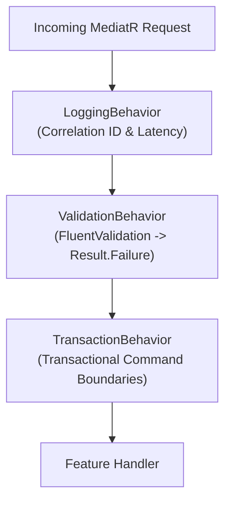

# RunbookForge — C# & .NET 9 Engineering Standards
**Document ID:** `docs/standards/CSHARP-STANDARDS.md`  
**Version:** 1.1.0  
**Status:** FROZEN  
**System:** RunbookForge (Workspace: `EphemeralEngine`)  

> **Context Dependencies:**  
> - **Source of Truth:** C# & .NET 9 Backend Standards (`standards/CSHARP-STANDARDS.md`)
> - **Global Invariants & Result Pattern:** [../04-CONVENTIONS-AND-GUARDRAILS.md](../04-CONVENTIONS-AND-GUARDRAILS.md)  
> - **Module Registry & Contracts:** [../01-MODULE-REGISTRY.md](../01-MODULE-REGISTRY.md)  
> - **Database Standards:** [./POSTGRES-SQL-STANDARDS.md](./POSTGRES-SQL-STANDARDS.md)  
> - **Testing Standards:** [./TESTING-STANDARDS.md](./TESTING-STANDARDS.md)

---

## 1. Language & Runtime Baseline

- **Target Framework:** `net9.0`
- **Language Version:** C# 13
- **Nullability Mode:** `<Nullable>enable</Nullable>`
- **Compiler Directives:** `<TreatWarningsAsErrors>true</TreatWarningsAsErrors>`

### Idiomatic C# 13 Patterns
```csharp
// 1. Primary Constructors for Dependency Injection
public sealed class CreateRunbookHandler(
    IRunbookRepository repository,
    ILogger<CreateRunbookHandler> logger) 
    : IRequestHandler<CreateRunbookCommand, Result<RunbookDraftDto>>
{
    // Injected fields are automatically in scope
}

// 2. Collection Expressions & Spread Operators
public IReadOnlyList<string> CombineTags(IReadOnlyList<string> existing, params string[] incoming) =>
    [..existing, ..incoming, "runbookforge"];

// 3. File-Scoped Types & Namespaces
namespace RunbookForge.Modules.RunbookEngine.Application.Features;

file sealed class LocalCacheHelper
{
    // Internal to this file only
}
```

---

## 2. MediatR Pipeline Behaviors

All requests dispatched via MediatR flow through three non-negotiable pipeline behaviors in `RunbookForge.BuildingBlocks.Common`:



### 2.1 ValidationBehavior (Non-Throwing)
Instead of throwing `ValidationException`, this pipeline behavior evaluates all registered `IValidator<TRequest>` instances and returns `Result.Failure(Error.Validation(...))` directly if any rule fails:

```csharp
public sealed class ValidationBehavior<TRequest, TResponse>(
    IEnumerable<IValidator<TRequest>> validators)
    : IPipelineBehavior<TRequest, TResponse>
    where TRequest : IRequest<TResponse>
    where TResponse : Result
{
    public async Task<TResponse> Handle(
        TRequest request,
        RequestHandlerDelegate<TResponse> next,
        CancellationToken cancellationToken)
    {
        if (!validators.Any()) return await next();

        var context = new ValidationContext<TRequest>(request);
        var validationResults = await Task.WhenAll(
            validators.Select(v => v.ValidateAsync(context, cancellationToken)));

        var failures = validationResults
            .SelectMany(r => r.Errors)
            .Where(f => f is not null)
            .ToList();

        if (failures.Count == 0) return await next();

        var errorMessage = string.Join("; ", failures.Select(f => $"{f.PropertyName}: {f.ErrorMessage}"));
        var validationError = Error.Validation("Request.ValidationFailed", errorMessage);

        // Reflective factory creation of generic Result<T>.Failure or non-generic Result.Failure
        if (typeof(TResponse) == typeof(Result))
        {
            return (TResponse)(object)Result.Failure(validationError);
        }

        var genericType = typeof(TResponse).GetGenericArguments()[0];
        var failureMethod = typeof(Result<>)
            .MakeGenericType(genericType)
            .GetMethod(nameof(Result<object>.Failure), [typeof(Error)]);

        return (TResponse)failureMethod!.Invoke(null, [validationError])!;
    }
}
```

### 2.2 TransactionBehavior
Wraps command execution in an isolated database transaction, ensuring atomicity without manual transaction boilerplate in feature handlers:

```csharp
public sealed class TransactionBehavior<TRequest, TResponse>(
    DbContext dbContext,
    ILogger<TransactionBehavior<TRequest, TResponse>> logger)
    : IPipelineBehavior<TRequest, TResponse>
    where TRequest : ICommand<TResponse>
    where TResponse : Result
{
    public async Task<TResponse> Handle(
        TRequest request,
        RequestHandlerDelegate<TResponse> next,
        CancellationToken cancellationToken)
    {
        // Skip transaction wrapping for read-only queries
        if (request is not ICommand<TResponse>) return await next();

        var strategy = dbContext.Database.CreateExecutionStrategy();
        return await strategy.ExecuteAsync(async () =>
        {
            await using var transaction = await dbContext.Database.BeginTransactionAsync(cancellationToken);
            var response = await next();

            if (response.IsSuccess)
            {
                await dbContext.SaveChangesAsync(cancellationToken);
                await transaction.CommitAsync(cancellationToken);
            }
            else
            {
                await transaction.RollbackAsync(cancellationToken);
            }

            return response;
        });
    }
}
```

---

## 3. EF Core Mapping & Persistence Standards

1. **Explicit Schema & Table Declaration:**
   ```csharp
   builder.ToTable("documents", "runbooks");
   ```
2. **Column Naming:** All database columns must use `snake_case`.
3. **Optimistic Concurrency with PostgreSQL `xmin`:**
   ```csharp
   builder.Property<uint>("Version")
       .IsRowVersion()
       .HasColumnName("xmin");
   ```
4. **Read-Only Projections:** All query handlers must invoke `.AsNoTracking()` or project directly via `.Select(x => new Dto(...))`.
5. **No Cross-Context Queries:** A module `DbContext` must only configure entity types belonging to its designated schema.
