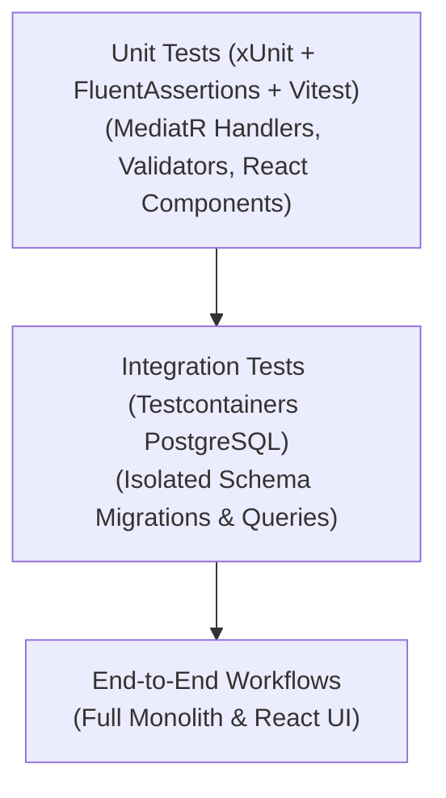

# RunbookForge — Automated Testing & Quality Standards
**Document ID:** `docs/standards/TESTING-STANDARDS.md`  
**Version:** 1.1.0  
**Status:** FROZEN  
**System:** RunbookForge (Workspace: `EphemeralEngine`)  

> **Context Dependencies:**  
> - **Source of Truth:** Testing Standards & Quality Gates (`standards/TESTING-STANDARDS.md`)
> - **Implementation SOP:** [../03-AI-FEATURE-SOP.md](../03-AI-FEATURE-SOP.md)  
> - **C# Standards:** [./CSHARP-STANDARDS.md](./CSHARP-STANDARDS.md)  
> - **TypeScript Standards:** [./TYPESCRIPT-REACT-STANDARDS.md](./TYPESCRIPT-REACT-STANDARDS.md)  
> - **F7Hub Security Barrier:** [../database/DB-06-EXTERNAL-F7HUB-READONLY.md](../database/DB-06-EXTERNAL-F7HUB-READONLY.md)

---

## 1. Test Automation Pyramid



---

## 2. Unit Testing Conventions (C# / .NET 9)

- **Frameworks:** xUnit 2.8+, FluentAssertions 7+, NSubstitute 5+
- **Naming Pattern:** `MethodName_ShouldExpectedBehavior_WhenStateUnderTest`
- **Isolation:** Never instantiate database connections or write to the file system in unit test projects.

```csharp
public class CreateRunbookHandlerTests
{
    private readonly IRunbookRepository _repository = Substitute.For<IRunbookRepository>();
    private readonly CreateRunbookHandler _handler;

    public CreateRunbookHandlerTests()
    {
        _handler = new CreateRunbookHandler(_repository, NullLogger<CreateRunbookHandler>.Instance);
    }

    [Fact]
    public async Task Handle_ShouldReturnSuccess_WhenCommandIsValid()
    {
        // Arrange
        var command = new CreateRunbookCommand("DB Failover", "db-failover", "Desc", "# Doc", ["postgres"]);
        _repository.IsSlugUniqueAsync(command.Slug, Arg.Any<CancellationToken>()).Returns(true);

        // Act
        var result = await _handler.Handle(command, CancellationToken.None);

        // Assert
        result.IsSuccess.Should().BeTrue();
        result.Value.Slug.Should().Be("db-failover");
        await _repository.Received(1).AddAsync(Arg.Any<RunbookDocument>(), Arg.Any<CancellationToken>());
    }

    [Fact]
    public async Task Handle_ShouldReturnConflict_WhenSlugAlreadyExists()
    {
        // Arrange
        var command = new CreateRunbookCommand("DB Failover", "db-failover", "Desc", "# Doc", ["postgres"]);
        _repository.IsSlugUniqueAsync(command.Slug, Arg.Any<CancellationToken>()).Returns(false);

        // Act
        var result = await _handler.Handle(command, CancellationToken.None);

        // Assert
        result.IsFailure.Should().BeTrue();
        result.Error.Type.Should().Be(ErrorType.Conflict);
        result.Error.Code.Should().Be("Runbook.SlugConflict");
    }
}
```

---

## 3. Integration Testing with Testcontainers

Integration tests execute against real PostgreSQL instances spun up via **Testcontainers.PostgreSql**:

```csharp
public class RunbookPersistenceTests : IAsyncLifetime
{
    private readonly PostgreSqlContainer _dbContainer = new PostgreSqlBuilder()
        .WithImage("postgres:17-alpine")
        .Build();

    public async Task InitializeAsync()
    {
        await _dbContainer.StartAsync();
        // Execute migrations for isolated schemas
    }

    public async Task DisposeAsync()
    {
        await _dbContainer.DisposeAsync();
    }
}
```

### 3.1 Testing F7Hub SQLite Read-Only Invariants
Integration tests must explicitly verify that any call to `SaveChangesAsync()` or `SaveChanges()` against `F7HubReadOnlyDbContext` throws `InvalidOperationException` (see [F7Hub Read-Only Adapter Specification](../database/DB-06-EXTERNAL-F7HUB-READONLY.md#2-hardened-f7hubreadonlydbcontext-implementation)):

```csharp
[Fact]
public async Task F7HubReadOnlyDbContext_ShouldThrow_OnSaveChangesAsync()
{
    // Arrange
    var options = new DbContextOptionsBuilder<F7HubReadOnlyDbContext>()
        .UseSqlite("Data Source=:memory:;Mode=ReadOnly;")
        .Options;

    await using var context = new F7HubReadOnlyDbContext(options);

    // Act
    var act = async () => await context.SaveChangesAsync();

    // Assert
    await act.Should().ThrowAsync<InvalidOperationException>()
        .WithMessage("*immutable read-only catalog*");
}
```

---

## 4. Frontend Unit Testing (Vitest & React Testing Library)

- **Frameworks:** Vitest, React Testing Library, `@testing-library/user-event`
- **Scope:** Component rendering, React Flow custom node state, and hook interactions.

```typescript
import { render, screen } from '@testing-library/react';
import { describe, it, expect } from 'vitest';
import { StepNode } from './StepNode';

describe('StepNode Component', () => {
  it('should render step title and command script', () => {
    const data = {
      stepId: 'step-1',
      title: 'Inspect Connections',
      stepType: 'AutomatedQuery' as const,
      commandScript: 'psql -c "SELECT 1;"',
    };

    render(<StepNode id="1" data={data} selected={false} type="step" zIndex={1} isConnectable={true} xPos={0} yPos={0} dragging={false} />);

    expect(screen.getByText('Inspect Connections')).toBeDefined();
    expect(screen.getByText('psql -c "SELECT 1;"')).toBeDefined();
  });
});
```

---

## 5. Execution Commands

```powershell
# Run backend test suite with normal verbosity
dotnet test --verbosity normal

# Run frontend unit tests
cd src/Frontend && npm run test && cd ../..
```

